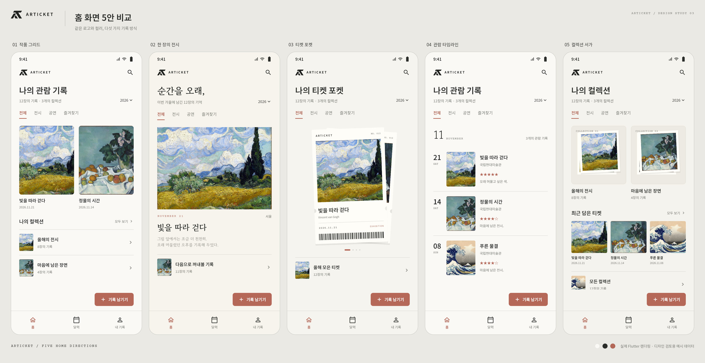
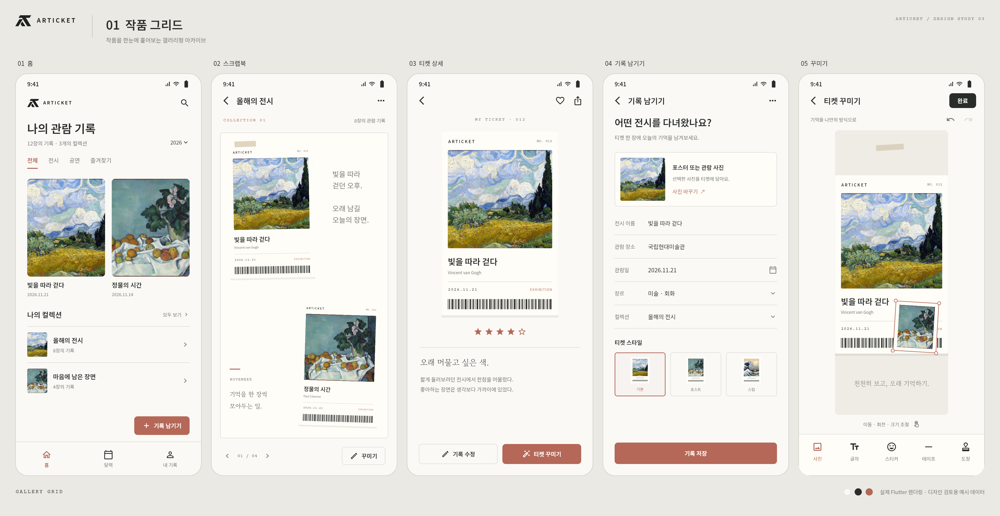
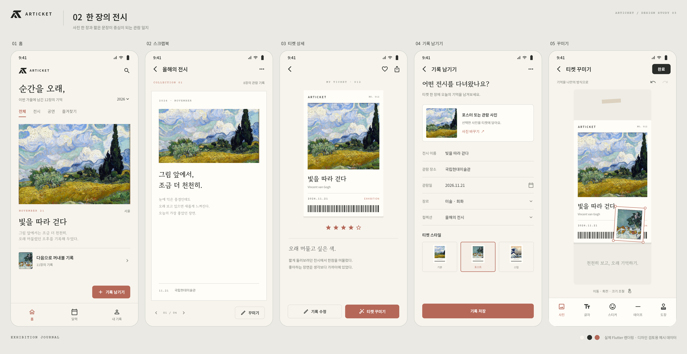
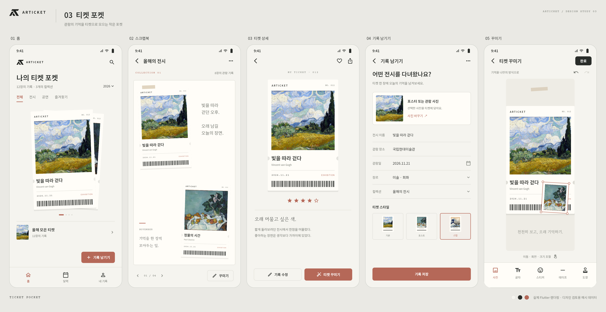
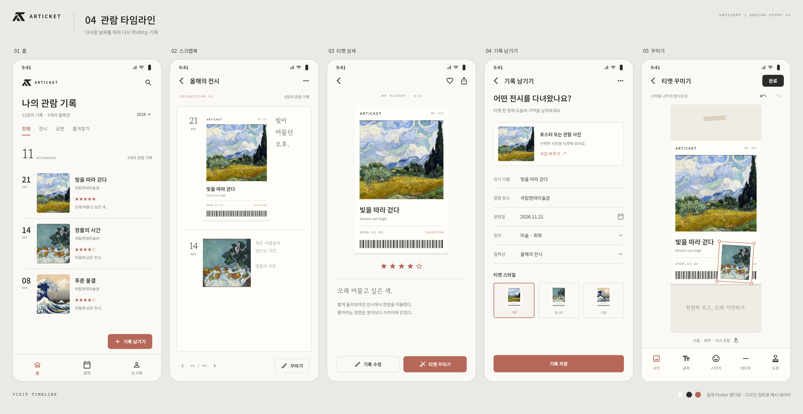
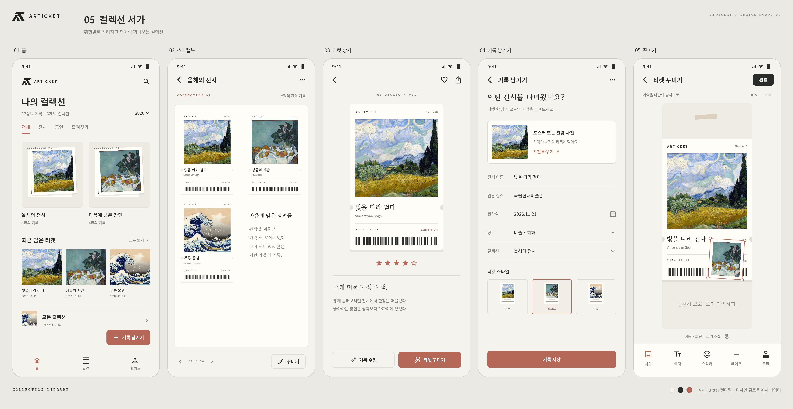

# Articket — 디자인 검토 03

**5종 × 각 5화면 = 총 25개 화면.** 승인한 05 AT 로고와 절제된 공통 컬러를 사용했습니다.
홈·스크랩북·티켓 상세·기록 남기기·꾸미기를 실제 Flutter 위젯으로 렌더링한 검토안입니다.

[**전체 시안 ZIP 다운로드**](https://github.com/joshuakod123/articket/raw/refs/heads/codex/design-review-v3/design_review/articket-design-review-v3.zip)

압축을 풀고 **index.html**을 열면 시안별로 25개 화면을 확대 비교할 수 있습니다.
새 디자인은 앱 main에 적용하지 않았습니다.

## 홈 화면 비교

## 각 시안의 5개 화면

### 01 작품 그리드

[원본 비교 이미지 열기](boards/concept-01.png)

### 02 한 장의 전시

[원본 비교 이미지 열기](boards/concept-02.png)

### 03 티켓 포켓

[원본 비교 이미지 열기](boards/concept-03.png)

### 04 관람 타임라인

[원본 비교 이미지 열기](boards/concept-04.png)

### 05 컬렉션 서가

[원본 비교 이미지 열기](boards/concept-05.png)

[리서치 자료·설계 기준](RESEARCH.md) · [작품 이미지 출처](ARTWORK_CREDITS.txt)
